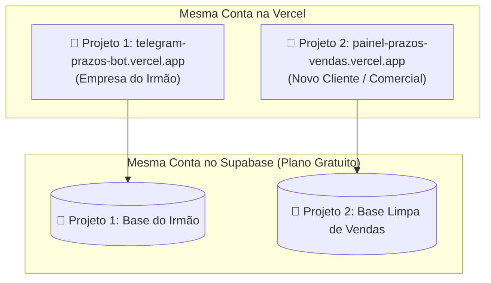

# 📐 Painel de Prazos & Processos — Versão Comercial (Vendas)
### Gestão Executiva para Escritórios de Arquitetura e Urbanismo

Plataforma completa, moderna e pronta para comercialização (*white-label*) para gestão de prazos, alvarás, aprovações municipais e processos de escritórios de arquitetura e urbanismo.

Esta versão foi especialmente desenhada para operação autônoma sem dependência do Telegram, incorporando **Notificações Nativas no Navegador (estilo Google Agenda)**, consulta em tempo real do **Diário Oficial da Prefeitura de São Paulo (DOSP/ARQUIP)** e arquitetura com **custo de infraestrutura zero** (Vercel + Supabase).

---

## 🚀 Principais Diferenciais da Versão Comercial

1. **🔔 Notificações Nativas do Navegador (Estilo Google):**
   - Alertas visuais e sonoros diretamente na área de trabalho/celular via **Web Notification API** e **Web Audio API** (sintetizador harmônico que dispensa arquivos de áudio externos).
   - **Novo Prazo Cadastrado:** Disparo imediato de notificação com número do processo, cliente e data de vencimento.
   - **Alerta Diário de Vencimentos:** Verificação inteligente ao abrir o painel alertando sobre prazos que vencem no dia ou que estão atrasados.
   - **Prazo Concluído:** Confirmação de baixa na tarefa.
   - Botão dedicado no cabeçalho (*"Ativar Alertas" / "Alertas Ativos"*) com status de permissão em tempo real.

2. **🏛️ Especializado em Arquitetura & Urbanismo:**
   - Identidade visual com o emblema oficial (Compasso de Precisão e Esquadro).
   - Vocabulário e campos adaptados para aprovações em prefeituras, alvarás de reforma/construção, regularizações e projetos urbanísticos.

3. **📱 Menu Lateral Moderno & Selecionável (Sidebar):**
   - Navegação lateral fluida no Desktop e gaveta deslizante (*Slide-Over Drawer*) no Mobile.
   - Acesso rápido a: **📊 Prazos & Processos**, **👥 Usuários & Acessos (exclusivo Admin)**, **📰 Diário Oficial (DOSP)**, **🔔 Alertas no Navegador**, **🔑 Alterar Senha**, **🌓 Modo Claro/Escuro** e **🚪 Sair**.

4. **🛡️ Controle de Acesso por Níveis (Admin vs. Operador):**
   - **Administrador (`admin`):**
     - Acesso irrestrito a todos os processos.
     - Pode **incluir prazos e atribuir a qualquer arquiteto** ou membro da equipe.
     - Pode editar e **excluir qualquer processo** do escritório.
     - Acesso ao menu **"Usuários & Acessos"** para cadastrar logins/senhas, definir perfis e redefinir senhas da equipe.
   - **Operador (`operador`):**
     - **Visualização transparente:** enxerga todos os processos do escritório para alinhamento da equipe.
     - Ao cadastrar um novo prazo, ele é **vinculado obrigatoriamente a si mesmo**.
     - Pode editar e **excluir estritamente os seus próprios processos** (não pode excluir nem editar processos de outros colegas).
     - Sem acesso ao menu de gestão de usuários.

5. **📰 Consulta do Diário Oficial de SP (DOSP / ARQUIP) Direto na Tela:**
   - Janela modal exclusiva que consulta despachos e publicações no Diário Oficial sem sair do painel e sem redigitar o processo.
   - Botão de 1 clique para abrir o portal oficial já filtrado em nova aba.

6. **👥 Gestão de Equipe & Segurança Individual:**
   - Tela de login com placeholder limpo e elegante.
   - Administrador pode criar usuários instantaneamente com senha inicial e cargo.
   - Cada arquiteto(a) ou colaborador(a) pode alterar sua própria senha no painel com persistência segura no banco de dados.

7. **📊 Exportação e Responsividade:**
   - Exportação para Excel (CSV compatível com acentuação e caracteres em português).
   - Impressão executiva / Salvamento em PDF com layout limpo e otimizado.
   - Modo escuro (*Dark Mode*) e modo claro (*Light Mode*).
   - Interface adaptada para smartphones (*Mobile First*).

---

## 🏗️ Como Usar a Mesma Conta da Vercel e Ter uma Base Limpa no Supabase

Você pode manter tudo de forma organizada, profissional e sem misturar registros com outras empresas:



### 1. Criar a Nova Base Limpa no Supabase (Mesma Conta)
O Supabase gratuito permite **até 2 projetos ativos simultâneos** por conta sem pagar nada:
1. Acesse o seu painel do [Supabase](https://supabase.com).
2. Clique no botão **"New Project"**.
3. Dê um nome ao projeto (ex: `prazos-arquitetura-vendas`) e defina uma senha de banco.
4. Vá em **SQL Editor** no menu lateral esquerdo, clique em **"New Query"**, cole todo o conteúdo do arquivo [`schema.sql`](./schema.sql) deste repositório e clique em **Run**.
5. Em **Project Settings ➡️ API**, copie a **Project URL** e a **service_role secret key**.

### 2. Hospedar na Vercel (Mesma Conta)
1. Acesse o seu painel da [Vercel](https://vercel.com).
2. Clique em **"Add New..." ➡️ "Project"**.
3. Selecione o repositório **`painel-prazos-vendas`**.
4. Em **Environment Variables**, adicione as seguintes variáveis:
   - `SUPABASE_URL`: *(URL copiada do novo projeto Supabase)*
   - `SUPABASE_SERVICE_ROLE_KEY`: *(Chave service_role copiada do novo projeto Supabase)*
   - `DASHBOARD_PASSWORD`: `prazos2026` *(ou a senha padrão que desejar)*
5. Clique em **Deploy**! Em menos de 1 minuto o painel estará no ar com domínio próprio e base 100% isolada.

---

## 📂 Estrutura de Arquivos

```text
painel-prazos-arquiteturas/
├── api/
│   ├── dashboard.ts       # Endpoint serverless: CRUD de prazos, auth e consulta DOSP
│   ├── cron.ts            # Disparos de rotinas automáticas
│   ├── webhook.ts         # Endpoint de webhook (opcional se ligar bot Telegram)
│   └── index.ts           # Rota de healthcheck da API
├── public/
│   ├── index.html         # SPA React 18 + Tailwind com Web Notifications e Audio Chime
│   └── manifest.json      # Configuração de Progressive Web App (PWA)
├── src/
│   ├── config.ts          # Gerenciamento de variáveis de ambiente flexíveis
│   ├── supabase.ts        # Modelos de dados e queries PostgreSQL no Supabase
│   ├── cron.ts            # Lógica de verificação de datas e dias restantes
│   ├── bot.ts             # Instância do Telegram opcional (não quebra se desativado)
│   ├── ai.ts              # IA Gemini para processamento de linguagem natural
│   └── server.ts          # Servidor Express de desenvolvimento local
├── schema.sql             # Script SQL de criação do banco de dados limpo
├── .env.example           # Exemplo de configuração das variáveis
└── vercel.json            # Roteamento e configuração serverless para Vercel
```

---

## 🔑 Credenciais Padrão Iniciais

Após subir o banco via `schema.sql`:
* **Usuário:** `admin` (ou `escritorio`)
* **Senha padrão:** `prazos2026` *(pode ser personalizada a qualquer momento no botão "Senha" do painel)*

---

## 📄 Licença
Versão comercial distribuível para escritórios de arquitetura e urbanismo.
